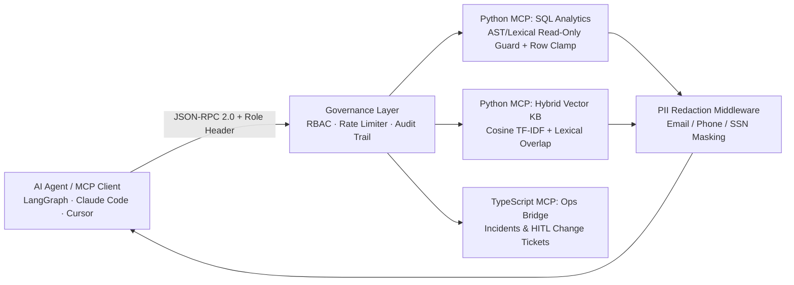

# MCP Enterprise Data Suite

[](https://github.com/mabdullah-ml/mcp-enterprise-data-suite/actions/workflows/ci.yml)
[](./LICENSE)
[](#)
[](#)
[](#)

> 🌐 **[日本語ドキュメントはこちら (README.ja.md)](./README.ja.md)**

A polyglot (**Python + TypeScript**) **Model Context Protocol (MCP)** server suite built for production enterprise AI agents (LangGraph, Claude Code, Cursor, Gemini CLI). Unlike toy MCP demos, every tool call flows through **read-only SQL guardrails, role-based access control (RBAC), automatic PII redaction, sliding-window rate limiting, and immutable audit logging**.

---

## Security & Protocol Architecture



---

## Included Production MCP Servers

| Server | Language | Tools Exposed | Enterprise Guardrails |
|---|---|---|---|
| **SQL Analytics Server** | Python (`FastAPI` + SQLite/PostgreSQL) | `sql_list_tables`, `sql_describe_table`, `sql_execute_readonly` | Blocks DDL/DML & `;` chaining, enforces `LIMIT <= 200`, role-based PII masking |
| **Hybrid Vector KB Server** | Python | `kb_search`, `kb_get_document` | Hybrid lexical + cosine ranking, category filters, owner PII redaction |
| **Enterprise Ops Bridge** | TypeScript (Node 22) | `ops_list_incidents`, `ops_create_change_ticket` | Scoped RBAC (`analyst` read-only vs `engineer`/`admin` create), mandatory HITL flag |

---

## Quick Start

### 1-Command Docker Compose

```bash
docker compose up --build
```

- Python MCP HTTP Gateway (`SQL + Vector KB`): `http://localhost:8080/mcp` (Audit Log: `GET /audit`)
- TypeScript Ops Bridge MCP Server: `http://localhost:8081/mcp`

### Run Tests Locally

```bash
# Python MCP Suite (SQL Guardrails, PII Redaction, Hybrid KB, RBAC & Rate Limiter)
cd python
pip install -e ".[dev]"
ruff check src tests
pytest -v

# TypeScript Ops Bridge MCP Server
cd ../typescript
npm install
npm run typecheck
npm test
```

### Example MCP JSON-RPC 2.0 Tool Call

```bash
curl -X POST http://localhost:8080/mcp \
  -H "Content-Type: application/json" \
  -H "X-Caller-Id: langgraph-analyst" \
  -H "X-Caller-Role: analyst" \
  -d '{
    "jsonrpc": "2.0",
    "id": 1,
    "method": "tools/call",
    "params": {
      "name": "sql_execute_readonly",
      "arguments": { "query": "SELECT company_name, contact_email, annual_contract_usd FROM customers" }
    }
  }'
```

*(For role `analyst`, `contact_email` is automatically masked as `[REDACTED_EMAIL]`; for `admin` with `pii:read`, full fields are returned and recorded in `/audit`.)*

---

## Author

**Abdullah Mamun, Ph.D.** — Senior Generative AI / LLM Engineer · Forward-Deployed AI Engineer · PMP  
[GitHub](https://github.com/mabdullah-ml) · [LinkedIn](https://www.linkedin.com/in/mamunabdullah01)
